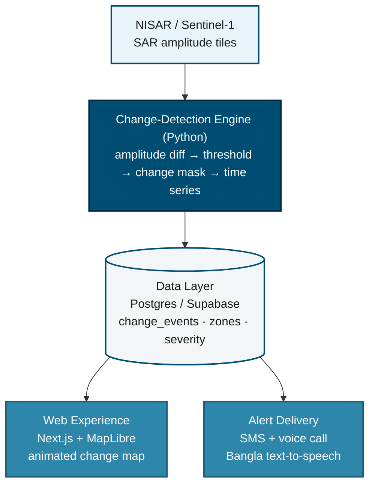

# Route200 Architecture

One change-detection engine, two consumers of the same output: a public web experience and a direct alert channel to people in risk zones. The engine is built once; both tracks read from the same event stream, so neither duplicates the other's work and either can evolve independently later.

## Diagram

## 1. Data ingestion

- **Primary**: NISAR GUNW/amplitude products over target AOIs (e.g. Jamuna/Padma char erosion, Chattogram hill-tract landslide zones).
- **Fallback**: Sentinel-1 GRD amplitude. Same differencing approach, available today, and keeps the pipeline running regardless of how NISAR's own product rollout timeline plays out.
- **Reference**: CEGIS historical erosion polygons (Jamuna, since 2004), used to sanity-check that detected change lines up with a known record rather than noise.

Every pulled scene is cached on ingestion, so the rest of the pipeline never depends on a live upstream call succeeding at request time.

## 2. Change-detection engine (Python)

Amplitude/backscatter change detection, not full InSAR interferometry:

1. Co-register two SAR amplitude scenes over the same area, different dates.
2. Difference and threshold to isolate open-water extent and bare-surface change.
3. Tag each change region with location, estimated area, and a severity score (rate of change against the historical baseline where CEGIS data covers it).
4. Emit a time-ordered stream of change events: the one artifact both tracks consume.

This is closer to ordinary image differencing than to interferometry, and it's the version that doesn't require a specialist radar background to get right. Interferometry is a reasonable later iteration once this simpler pipeline is proven out.

## 3. Data layer

- Postgres/Supabase.
- `change_events`: location, date range, area, severity, source scene references.
- `zones`: named risk areas, each mapped to the set of registered contact numbers for the households within it.
- An API layer (Node/Next API routes) sits in front of both tables. Neither consumer track talks to Postgres directly.

## 4. Web experience

- Next.js + Tailwind, Bangla-first copy.
- MapLibre/Leaflet map, animating the engine's change time series as a before/after sequence over the selected area.
- Public-facing, no login required for the baseline view. Built to make the risk legible and shareable.

## 5. Alert delivery

- Automated SMS and automated voice calls (Bangla text read aloud via text-to-speech) sent to the registered numbers for a zone.
- Triggered automatically when a zone's severity crosses a threshold in `change_events`, with no manual step in between.
- Reaches people with no smartphone and no data plan; a phone call or text is the only interface required on their end.

## 6. Infra

- Docker for the pipeline and API.
- Nginx + GitHub Actions + a VPS/Cloudflare for the web track.
- Retries and local caching around every upstream data fetch, so a transient outage in one source never takes the whole service down.

## Risks

- **NISAR data maturity is unverified as of this writing.** The Sentinel-1 fallback keeps the pipeline functional regardless of how that resolves.
- **Upstream API availability**: mitigated by caching fetched scenes and degrading gracefully (serving the last known-good change map) rather than failing outright.
- **Overclaiming severity**: outputs should be labeled as decision support, cite their sources, and state their limitations; false confidence in a risk alert is worse than no alert at all.
